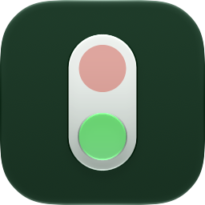
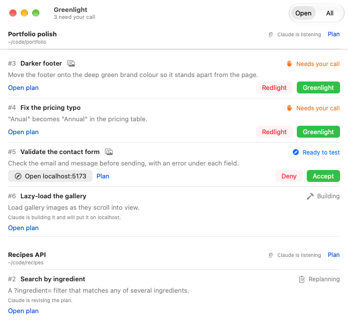
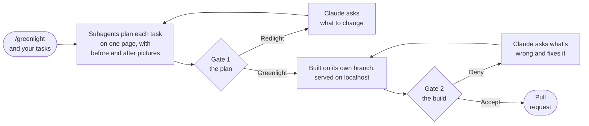
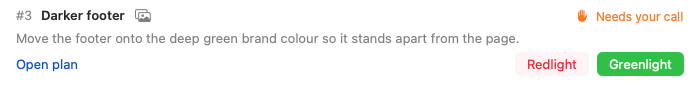
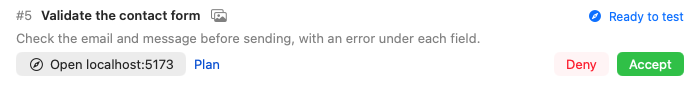
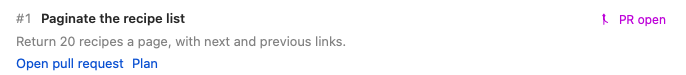
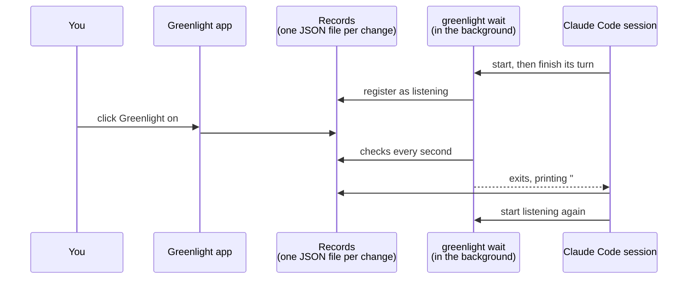
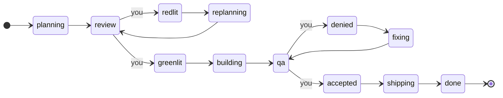

<p align="center">
  
</p>

<h1 align="center">Greenlight</h1>

<p align="center">
  <strong>Nothing gets built until you say go. Nothing gets merged until you've tried it.</strong><br>
  A Claude Code skill and a small Mac app that put two sign-offs on every change Claude makes.
</p>

<br>

Hand Claude Code a list of tasks with `/greenlight` and it doesn't start coding. It sends a subagent to plan each task, then publishes one plan page for the batch, with before and after pictures for anything you'd see change. Each change waits in the Greenlight app until you **greenlight** or **redlight** it. Greenlit changes get built on their own branch and put on localhost. You try them, then **accept** or **deny**. Only an accepted change becomes a pull request.

The app is how Claude hears you. Click a button and the waiting Claude session wakes up and gets on with it. Redlight something and Claude comes back to ask what you'd like changed.

<p align="center">
  <picture>
    <source media="(prefers-color-scheme: dark)" srcset="docs/screenshots/window-dark.png">
    
  </picture>
</p>

<p align="center"><em>Two batches in two repositories. The screenshots use demo data.</em></p>

## How it works



One task becomes one change, one branch and one pull request. You decide on each change separately, so you can send one back while the others go ahead.

### Gate 1: the plan

<picture>
  <source media="(prefers-color-scheme: dark)" srcset="docs/screenshots/gate-plan-dark.png">
  
</picture>

**Open plan** jumps to the change's section of the plan page: what Claude will do, in plain words, which files it will touch, the tests it will add and anything it wants to check with you. A visual change shows the page as it is now next to how it will look, at desktop and phone size. Claude makes the "after" picture by applying the change to the real page in a browser, without touching your code.

**Greenlight** and Claude starts building. **Redlight** and Claude asks you what to change, one question at a time, then updates the same plan page and puts it back in front of you.

### Gate 2: the build

<picture>
  <source media="(prefers-color-scheme: dark)" srcset="docs/screenshots/gate-build-dark.png">
  
</picture>

Each greenlit change is built by its own subagent, in its own git worktree, branched from your default branch. It comes with tests, and Claude opens it in a browser at phone and desktop width before handing it over. Then it's served on its own localhost port. **Open localhost** takes you straight to it.

**Accept** and Claude pushes the branch and opens the pull request. **Deny** and Claude asks what's wrong, fixes it and puts it back for you to try. If the change has no web page to look at (a command-line tool, a library, a native app), Claude serves a page on localhost instead, with what changed, how to try it, the test results and the diff.

### Then: the pull request

<picture>
  <source media="(prefers-color-scheme: dark)" srcset="docs/screenshots/gate-pr-dark.png">
  
</picture>

The pull request links back to the plan and says how the change was tested. The finished change moves out of the way. Switch the window to **All** to see it again.

## Installing

You'll need macOS 26 or later, Xcode 26 or later, [XcodeGen](https://github.com/yonaskolb/XcodeGen), [Claude Code](https://claude.com/claude-code) and the [GitHub CLI](https://cli.github.com) signed in to your account.

```
brew install xcodegen gh
git clone https://github.com/LBSiUK/Greenlight.git
cd Greenlight
./build.sh
```

`build.sh` builds a Release copy, copies it to `/Applications` and opens it. Each time it opens from Applications, Greenlight:

- links the `greenlight` command into `~/.local/bin` (add that folder to your `PATH` if it isn't already)
- copies its Claude Code skill to `~/.claude/skills/greenlight`, so `/greenlight` works in your next session

Two optional extras the skill uses when they're there: [Localhosts](https://github.com/LBSiUK/Localhosts), which labels each change's server in your menu bar, and `playwright-cli`, for the before and after pictures.

## Using it

In any git repository, start Claude Code and type `/greenlight` with your tasks:

```
/greenlight 1. make the footer dark green  2. fix the "Anual" typo on the pricing page
3. add inline validation to the contact form
```

Claude replies with a link to the plan and opens Greenlight. From there it's all buttons:

| Change is… | You see | What happens next |
| --- | --- | --- |
| Needs your call | Open plan, **Redlight**, **Greenlight** | Claude builds it, or asks what to change |
| Ready to test | Open localhost, **Deny**, **Accept** | Claude opens the pull request, or asks what's wrong |
| Planning, Building, Fixing, Opening PR | what Claude is doing | nothing to do yet |
| PR open | Open pull request | done |

Each batch shows whether a Claude session is listening for that repository. If it says **Claude isn't listening** (you closed the terminal, say), your clicks are saved. Type `/greenlight` on its own in that repository and Claude picks up where things were: it acts on your calls, restarts any localhost servers that have stopped and starts listening again.

You can also decide in the conversation. Tell Claude "greenlight 4" or "drop 5" and it updates the app to match.

## How Claude hears your clicks



Before it finishes each turn, Claude starts `greenlight wait` in the background. It waits until you make a call on a change in that repository, prints what you decided, and exits. Claude Code wakes the session when a background command finishes, so Claude acts on your click within about a second, or as soon as it has finished whatever step it was in the middle of.

The app and the command share a folder of small JSON files, one per batch, change and listener. Every write takes a file lock and replaces the file in one go, so a click and a command at the same moment can't lose each other's changes. A button that's out of date (because Claude moved the change on a moment ago) is refused rather than undoing Claude's work.

## The `greenlight` command

The app and the command are the same program. Claude uses it, and so can you:

```
greenlight new "<batch title>" [--project PATH]   start a batch of changes for a git repo
greenlight add <batch> "<title>" [--summary TEXT] [--visual]
greenlight plan <batch> <artifact url>           record the plan link; put the batch up for review
greenlight set <id> [--stage STAGE] [--qa URL] [--pr URL] [--branch NAME] [--title TEXT] [--summary TEXT]
greenlight list [--done] [--all-projects] [--json]
greenlight show <id>                             one change as JSON, with its plan link
greenlight folder <batch>                        where the batch's plan page and pictures go
greenlight wait [--all-projects] [--timeout SECONDS]
```

```
$ greenlight list
#3    review      waits for the user  Darker footer  [batch 2: Portfolio polish]
#4    review      waits for the user  Fix the pricing typo  [batch 2: Portfolio polish]
#5    qa          waits for the user  Validate the contact form  http://localhost:5173/contact  [batch 2: Portfolio polish]
#6    building    waits for Claude    Lazy-load the gallery  [batch 2: Portfolio polish]
```

`greenlight wait` exits with 0 when there are calls to pick up, 3 when nothing is open in the repository, 4 when `--timeout` runs out and 5 when another `wait` is already listening there. Every command works from the repository or any of its worktrees.

### Stages



You move changes out of `review` and `qa`. Claude moves them everywhere else, and can mark one `dropped` if you tell it to.

### Where things live

| What | Where |
| --- | --- |
| Batches, changes and listeners | `~/Library/Application Support/Greenlight` (or `$GREENLIGHT_HOME`) |
| A batch's plan page, pictures and test pages | `.greenlight/<batch>` in the repository, which Greenlight adds to `.git/info/exclude` so it never gets committed |
| Each change's worktree | `../<repo>-greenlight/<id>`, next to the repository, removed once its pull request is open |
| The skill | [`skill/SKILL.md`](skill/SKILL.md), copied to `~/.claude/skills/greenlight` |

The plan pages are Claude Code Artifacts: private pages on your claude.ai account that you can share if you want to. Everything else stays on your Mac, and the app itself makes no network requests.

## Building it yourself

`./build.sh` builds and installs a Release copy. To run the tests:

```
xcodegen generate
xcodebuild -project Greenlight.xcodeproj -scheme Greenlight test
```

Builds are signed to run locally by default. To sign with your own certificate, see the note at the top of `Config/Base.xcconfig`.

The skill in `~/.claude/skills/greenlight` is replaced with the bundled copy each time the app opens, so make changes to `skill/SKILL.md` and run `./build.sh`.

Debug builds have a demo mode with made-up batches, used for the screenshots: `Greenlight.app/Contents/MacOS/Greenlight -demo YES`. The options are listed at the top of `Greenlight/App/Demo.swift`.

### Project layout

| Path | What's there |
| --- | --- |
| `Greenlight/App` | App entry point, the `Board` the window shows, the installer and demo data |
| `Greenlight/Core` | Stages, batches and changes, and the `Ledger` that reads and writes the records |
| `Greenlight/CLI` | The `greenlight` command |
| `Greenlight/Views` | The window, batch headers and change rows |
| `Greenlight/Resources` | App icon (Icon Composer) and asset catalogue |
| `GreenlightTests` | Unit tests (Swift Testing), including the listener waking up on a click |
| `skill/SKILL.md` | The Claude Code skill, bundled into the app |
| `project.yml` | XcodeGen project definition |
| `build.sh` | Builds a Release copy and installs it to `/Applications` |

## Status

New, and working. Things to know:

- There are no downloadable builds yet, so you build it from source.
- Pull requests go to GitHub through `gh`. For a repository without a GitHub remote, Claude asks you what to do instead.
- Claude only hears your clicks while a session in that repository is running. Your calls are kept in the meantime, and `/greenlight` picks them up.

## Credits

Copyright © 2026 LBSi UK / Leon Brahams

https://github.com/LBSiUK/Greenlight
